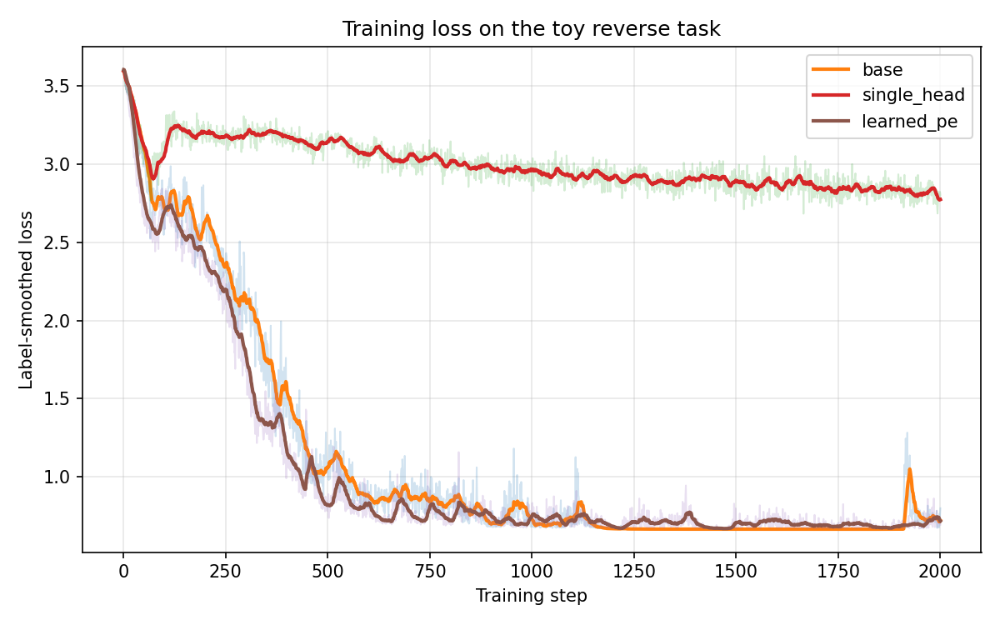
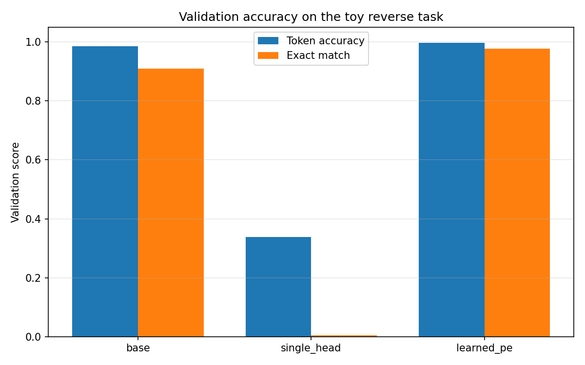
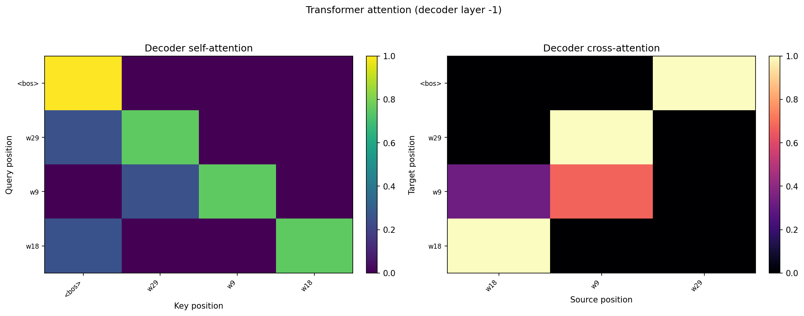

> 贡献者：[SunMuzihang] ([2260031490])

<div align="center">

# Transformer From Scratch

**A from-scratch PyTorch reproduction of “Attention Is All You Need”.**

[](https://www.python.org/)
[](https://pytorch.org/)
[](LICENSE)

</div>

---

## Overview

This repository is a week-by-week, from-scratch implementation of the original Transformer architecture (Vaswani et al., 2017). Rather than wrapping `torch.nn.Transformer`, every component is written and tested explicitly so the code can be read side by side with the paper.

The project now includes:

- a from-scratch encoder–decoder Transformer,
- a small training pipeline with label smoothing and the Noam learning-rate schedule,
- a synthetic sequence-to-sequence benchmark,
- reproducible ablation scripts, loss curves, and attention visualizations.

## Current Progress

**Week 1 — attention and positional encoding**

- Multi-head attention with scaled dot-product attention
- Padding masks and causal look-ahead masks
- Fixed sinusoidal and learned positional encodings
- Token embeddings scaled by `sqrt(d_model)`

**Week 2 — full Transformer**

- Position-wise feed-forward network
- Post-LN residual connections: `LayerNorm(x + dropout(sublayer(x)))`
- Encoder and decoder stacks
- Automatic causal and padding masks
- Output projection tied to the target embedding
- Forward-pass tests for shapes, causality, padding, gradients, and weight tying

**Week 3 — training pipeline**

- Vocabulary and synthetic reverse/copy dataset
- Label-smoothed cross-entropy
- Noam learning-rate scheduler from the paper
- Checkpoint save/restore
- Minimal CPU training script

**Week 4 — experiments and documentation**

- Token accuracy, exact-match, and evaluation engine
- Multi-head vs single-head ablation
- Sinusoidal vs learned positional-encoding ablation
- Training-loss curves and validation-accuracy plots
- Decoder self-attention and cross-attention heatmaps

## Project Structure

```text
.
├── model/
│   ├── __init__.py        # Public exports
│   ├── attention.py       # Scaled dot-product & multi-head attention
│   ├── embedding.py       # Token embedding + sinusoidal/learned PE
│   ├── feed_forward.py    # Position-wise feed-forward network
│   ├── layers.py          # Post-LN sublayers, cloning, padding masks
│   ├── encoder.py         # Encoder layer and stack
│   ├── decoder.py         # Decoder layer and stack
│   └── transformer.py     # Full encoder–decoder model
├── data/
│   ├── __init__.py
│   ├── dataset.py         # Toy sequence-to-sequence dataset
│   └── vocab.py           # Vocabulary and special tokens
├── training/
│   ├── __init__.py
│   ├── checkpoint.py      # Checkpoint save/restore
│   ├── engine.py          # Train/evaluate helpers
│   ├── loss.py            # Label-smoothed cross-entropy
│   ├── metrics.py         # Token accuracy and exact match
│   └── scheduler.py       # Noam learning-rate schedule
├── scripts/
│   ├── train.py           # CPU training smoke test
│   ├── run_experiments.py # Multi-head / positional-encoding ablations
│   └── visualize_attention.py
├── tests/
│   ├── test_forward.py
│   ├── test_training.py
│   └── test_experiments.py
├── results/               # Generated plots and metrics
├── .gitignore
├── LICENSE
├── README.md
└── requirements.txt
```

## Environment Setup

```bash
git clone https://github.com/sunmu-length/transformer-from-scratch.git
cd transformer-from-scratch

python -m venv .venv
source .venv/bin/activate          # Linux / macOS
# .venv\Scripts\activate           # Windows

pip install -r requirements.txt
```

Requires Python 3.10+ and PyTorch 2.x. The experiments run on CPU.

## Quick Verification

Run the test suite from the repository root:

```bash
python -m pytest -q
```

Expected output:

```text
29 passed
```

Run a short 10-step training smoke test:

```bash
python scripts/train.py --steps 10
```

Expected output is a sequence of finite losses around `3.5`, ending with:

```text
done | steps=10 | mean loss=3.5406 | final loss=3.5070
```

## Reproducing the Experiments

The toy task reverses a random sequence of 3–8 tokens. The reported run uses 2,048 training sequences, 256 validation sequences, 2,000 optimizer steps, batch size 32, and dropout 0.0 on CPU.

```bash
python scripts/run_experiments.py
python scripts/visualize_attention.py
```

The first command writes metrics and plots to `results/`. The second writes `results/attention_heatmap.png`.

## Results

### Ablation

| Config | Heads | Positional encoding | Parameters | Val loss | Token accuracy | Exact match |
|---|---:|---|---:|---:|---:|---:|
| Base | 4 | Sinusoidal | 169,728 | 0.1818 | 98.50% | 91.02% |
| Single-head | 1 | Sinusoidal | 169,728 | 2.6895 | 33.81% | 0.39% |
| Learned PE | 4 | Learned | 171,008 | 0.1252 | 99.64% | 97.66% |

Training uses label smoothing `0.1` and the Noam schedule. The training curves show the label-smoothed training loss; the validation loss in the table is plain cross-entropy.





### Attention Visualization

The last decoder layer learns the alignment needed for the reverse task. The example maps source tokens `w18 w9 w29` to target tokens `<bos> w29 w9 w18`.



## Ablation Notes

- **Multi-head attention matters.** Reducing 4 heads to 1 collapses token accuracy from 98.50% to 33.81% and exact match from 91.02% to 0.39% on this task. A single head has to mix several alignment patterns through one subspace.
- **Learned positional encodings are slightly better here.** They reach 99.64% token accuracy and 97.66% exact match, versus 98.50% and 91.02% for the sinusoidal encoding. This is a small, in-distribution toy task; the sinusoidal encoding remains the default because it follows the paper and can extrapolate to longer sequences.
- These numbers come from a single seed on a synthetic task. They are intended as a reproducible sanity check, not a general claim about Transformer variants.
- BLEU is not meaningful for synthetic `w0…w31` tokens, so token accuracy and exact match are used. BLEU evaluation on a real corpus is left as future work.

## Roadmap

- [x] **Week 1** — Multi-Head Attention and positional encoding
- [x] **Week 2** — Encoder, Decoder, and the full-model forward pass
- [x] **Week 3** — Training pipeline, data loader, loss, and Noam scheduler
- [x] **Week 4** — Ablation experiments, results, and documentation

## References

Vaswani, A., Shazeer, N., Parmar, N., Uszkoreit, J., Jones, L., Gomez, A. N., Kaiser, Ł., and Polosukhin, I. “Attention Is All You Need.” *NeurIPS*, 2017.

## License

Released under the [MIT License](LICENSE).
