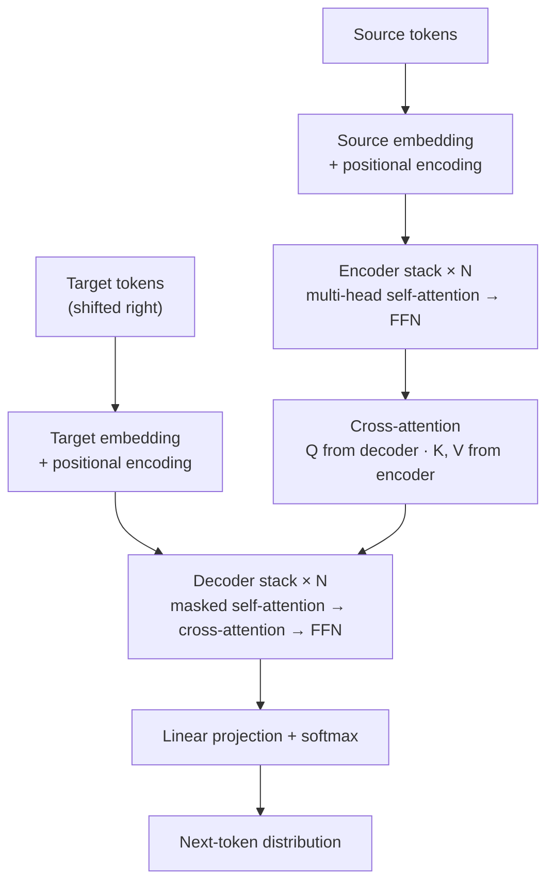

<div align="center">

# Transformer From Scratch

**A readable, from-scratch PyTorch implementation of “Attention Is All You Need”.**

[](https://www.python.org/)
[](https://pytorch.org/)
[](LICENSE)

</div>

---

## Table of Contents

- [Introduction](#introduction)
- [Architecture](#architecture)
- [Environment Setup](#environment-setup)
- [Quick Start](#quick-start)
- [Results / Ablation](#results--ablation)
- [Project Structure](#project-structure)
- [Roadmap](#roadmap)
- [Citation](#citation)
- [License](#license)

---

## Introduction

*Attention Is All You Need* (Vaswani et al., 2017) replaced recurrence with pure attention and became the foundation of modern language models. This repository reimplements the original **encoder–decoder Transformer** from scratch in idiomatic PyTorch, with code organized so that it can be read side by side with the paper. Every core component — multi-head attention, sinusoidal positional encoding, padding and causal masking, the Noam learning-rate schedule, label smoothing, and beam-search decoding — is implemented explicitly, without relying on `torch.nn.Transformer` or `torch.nn.MultiheadAttention`.

**Highlights**

- **Complete encoder–decoder stack** — trained end-to-end on a sequence-to-sequence translation task.
- **No black boxes** — attention, feed-forward layers, residual/LayerNorm blocks, and masking are all written module by module.
- **Correct masking** — padding masks on encoder/decoder keys and a causal mask in decoder self-attention, covered by unit tests.
- **Pluggable positional encodings** — sinusoidal (as in the paper) and learned embeddings, enabling a controlled ablation.
- **Reproducible experiments** — seed-controlled training, YAML configs, and an ablation harness that isolates one design choice at a time.

## Architecture



### Core components

- **Scaled Dot-Product Attention** — attention weights are computed from query–key similarity, scaled by `1 / sqrt(d_k)` to stabilize gradients:

  $$\mathrm{Attention}(Q,K,V)=\mathrm{softmax}\!\left(\frac{QK^{\top}}{\sqrt{d_k}}\right)V$$

- **Multi-Head Attention** — `h` attention heads run in parallel on projected subspaces; their outputs are concatenated and projected with `W^O`, letting the model attend to different representation subspaces at once.
- **Sinusoidal Positional Encoding** — injects token order into an otherwise permutation-invariant architecture. The paper's fixed encoding is used by default, with a learned embedding variant available for ablation:

  $$PE_{(pos,\,2i)}=\sin\!\left(\frac{pos}{10000^{2i/d_{model}}}\right),\qquad
  PE_{(pos,\,2i+1)}=\cos\!\left(\frac{pos}{10000^{2i/d_{model}}}\right)$$

- **Position-wise Feed-Forward Network** — a two-layer MLP with ReLU applied independently at every position:

  $$\mathrm{FFN}(x)=\max(0,\;xW_1+b_1)\,W_2+b_2$$

- **Residual Connections & Layer Normalization** — sublayer outputs are wrapped in residual connections and normalized, following the original Post-LN formulation.
- **Padding & Causal Masks** — padding tokens are excluded from attention scores in both encoder and decoder; decoder self-attention additionally uses a causal mask so position `t` can only attend to positions `≤ t`.
- **Encoder & Decoder Stacks** — `N` identical layers per stack, with the decoder inserting cross-attention between its masked self-attention and feed-forward sublayers.
- **Weight Sharing** — token embeddings and the output projection can share weights, as in the paper.

### Reference configuration

| Hyperparameter | Paper (base model) |
| :--- | ---: |
| Encoder / decoder layers (`N`) | 6 |
| Model dimension (`d_model`) | 512 |
| Attention heads (`h`) | 8 |
| Key/value dimension (`d_k = d_v`) | 64 |
| Feed-forward dimension (`d_ff`) | 2048 |
| Dropout | 0.1 |
| Warmup steps | 4,000 |
| Label smoothing | 0.1 |

The reduced **mini-scale** profile used for the ablation study is defined in [`configs/mini.yaml`](configs/mini.yaml).

## Environment Setup

**Requirements**

- Python ≥ 3.10
- PyTorch ≥ 2.0 (CPU or CUDA build)
- A CUDA-capable GPU is recommended for training; inference runs comfortably on CPU

```bash
# 1. Clone the repository
git clone https://github.com/sunmu-length/transformer-from-scratch.git
cd transformer-from-scratch

# 2. Create and activate a virtual environment
python -m venv .venv
source .venv/bin/activate          # Linux / macOS
# .venv\Scripts\activate           # Windows (PowerShell / cmd)

# 3. Install dependencies
pip install --upgrade pip
pip install -r requirements.txt
```

Optional — install the CUDA 11.8 build of PyTorch:

```bash
pip install torch --index-url https://download.pytorch.org/whl/cu118
```

Verify the installation:

```bash
python -c "import torch; print(torch.__version__, torch.cuda.is_available())"
```

| Dependency | Purpose |
| :--- | :--- |
| PyTorch | Model definition and training |
| PyYAML | Configuration files |
| sacreBLEU | BLEU evaluation |
| tqdm | Training progress bars |
| pytest | Unit tests |

## Quick Start

All scripts expose `--help`; the flags below are the common ones.

### 1. Prepare the data

```bash
python scripts/prepare_data.py --dataset multi30k --dest data/multi30k
```

This downloads and tokenizes the parallel corpus and writes the train/validation/test splits and vocabulary files under `data/multi30k/`.

### 2. Train

```bash
python scripts/train.py --config configs/mini.yaml
```

Common overrides:

```bash
python scripts/train.py --config configs/mini.yaml --seed 42
python scripts/train.py --config configs/mini.yaml --device cuda --batch-size 64
```

Checkpoints, logs, and metrics are written to `checkpoints/` and `logs/`.

### 3. Evaluate

```bash
python scripts/evaluate.py \
    --checkpoint checkpoints/mini/best.pt \
    --split test \
    --beam-size 4
```

### 4. Translate

```bash
python scripts/translate.py \
    --checkpoint checkpoints/mini/best.pt \
    --src "A man is riding a horse." \
    --beam-size 4
```

### 5. Run the tests

```bash
pytest -q
```

The test suite checks tensor shapes, padding/causal mask behavior, attention normalization, and positional-encoding properties.

## Results / Ablation

The original paper trains on WMT14 EN–DE (≈4.5M sentence pairs) for 3.5 days on 8 GPUs, which is out of scope for a single-machine reproduction. This repository instead reproduces the paper's **relative trends at mini scale** — a small parallel corpus, fewer layers, a narrower model, and short training runs. The goal is to compare architectural choices under identical conditions, not to match the reported 28.4 BLEU.

### Mini-scale setup

| Setting | Value |
| :--- | :--- |
| Task | English → German translation |
| Dataset | Multi30k (default; any parallel corpus can be plugged in) |
| Model | Mini profile — see [`configs/mini.yaml`](configs/mini.yaml) |
| Metric | sacreBLEU (detokenized) |
| Decoding | Beam search, beam size 4 |
| Hardware | Single GPU |

### Ablation results

All runs use the same data, seed, optimizer, and training budget; only the listed factor changes.

| Run | Heads | Positional encoding | Params | Test BLEU | Δ vs. baseline |
| :--- | :---: | :---: | ---: | ---: | ---: |
| Baseline | 8 | Sinusoidal | TBD | TBD | — |
| Single-head | 1 | Sinusoidal | TBD | TBD | TBD |
| Learned PE | 8 | Learned | TBD | TBD | TBD |

<!--
TODO before publishing:
  1. Replace every "TBD" with the final numbers (mean ± std over the seeds you ran).
  2. Add 2–3 sentences below the table interpreting the results, e.g.:
     - Does multi-head attention outperform the single-head variant at equal parameter count?
     - Is the learned positional encoding on par with, better than, or worse than sinusoidal?
     - How large is the gap relative to seed variance?
  3. Report the training budget (steps/epochs, wall-clock, GPU model) so the numbers are reproducible.
-->

### Figures

<!--
TODO: generate these plots and uncomment the block below.

  1. docs/figures/training_curves.png
     Train/validation loss and validation BLEU vs. optimization step,
     with all three ablation runs overlaid on the same axes.

  2. docs/figures/attention_maps.png
     Attention heatmaps for one example sentence: encoder self-attention,
     decoder self-attention (showing the causal triangle), and decoder
     cross-attention.

  3. docs/figures/positional_encodings.png
     A heatmap of the sinusoidal positional-encoding matrix, and optionally
     the learned embedding matrix for comparison.


*Figure 1 — Training dynamics for the baseline, single-head, and learned-PE runs.*


*Figure 2 — Encoder self-attention, causal decoder self-attention, and encoder–decoder cross-attention.*


*Figure 3 — Sinusoidal positional encoding (left) vs. learned positional embeddings (right).*
-->

### Reproducing the ablation

```bash
# Baseline: 8 heads, sinusoidal positional encoding
python scripts/train.py --config configs/mini.yaml \
    --num-heads 8 --pos-encoding sinusoidal --seed 42

# Single-head attention
python scripts/train.py --config configs/mini.yaml \
    --num-heads 1 --pos-encoding sinusoidal --seed 42

# Learned positional encoding
python scripts/train.py --config configs/mini.yaml \
    --num-heads 8 --pos-encoding learned --seed 42
```

## Project Structure

```text
.
├── configs/                  # YAML experiment configs
│   ├── mini.yaml             # Reduced profile used for the ablations
│   └── base.yaml             # Paper-style base configuration
├── data/                     # Data loading and tokenization
│   ├── dataset.py            # Parallel corpus, batching, padding
│   ├── tokenizer.py          # Tokenization and detokenization
│   └── vocab.py              # Vocabulary construction and special tokens
├── model/                    # Model components, one concern per file
│   ├── attention.py          # Scaled dot-product & multi-head attention
│   ├── embedding.py          # Token embedding + sinusoidal/learned PE
│   ├── feed_forward.py       # Position-wise feed-forward network
│   ├── layers.py             # Residual + LayerNorm, mask utilities
│   ├── encoder.py            # Encoder layer and stack
│   ├── decoder.py            # Decoder layer and stack
│   └── transformer.py        # End-to-end model, weight init & sharing
├── scripts/
│   ├── prepare_data.py       # Download, tokenize, build vocabularies
│   ├── train.py              # Training loop, Noam schedule, label smoothing
│   ├── evaluate.py           # BLEU evaluation on validation/test splits
│   └── translate.py          # Greedy and beam-search inference
├── utils/
│   ├── checkpoint.py         # Save/load checkpoints
│   ├── lr_scheduler.py       # Noam warmup schedule
│   ├── metrics.py            # BLEU wrapper
│   └── logging.py            # Console and file logging
├── tests/                    # Unit tests for shapes, masks, attention
├── requirements.txt
├── LICENSE
└── README.md
```

## Roadmap

- [ ] Subword tokenization (BPE / SentencePiece) to replace word-level vocabularies
- [ ] Mixed-precision training and gradient accumulation
- [ ] Multi-GPU training with `DistributedDataParallel`
- [ ] Export to TorchScript / ONNX for deployment
- [ ] Reproduce the paper's base configuration on a larger corpus

## Citation

If you use or reference this implementation, please cite the original paper:

```bibtex
@inproceedings{vaswani2017attention,
  title     = {Attention Is All You Need},
  author    = {Vaswani, Ashish and Shazeer, Noam and Parmar, Niki and Uszkoreit, Jakob
               and Jones, Llion and Gomez, Aidan N. and Kaiser, Lukasz and Polosukhin, Illia},
  booktitle = {Advances in Neural Information Processing Systems},
  volume    = {30},
  year      = {2017}
}
```

## License

Released under the [MIT License](LICENSE).
